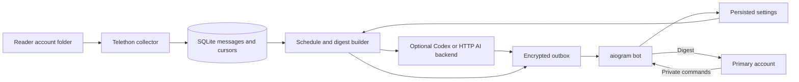

# Architecture

Python 3.13, Telethon, aiogram, SQLite, one application process with asyncio tasks. The reader account and bot owner are separate. Source code and controls are English; digest language is persisted as a bot-selected client preference.

## Membership and collection

`messages.getDialogFilters` supplies explicit included/pinned peers and exclusions. See [Telegram folder documentation](https://core.telegram.org/api/folders). Collection never automatically joins chats. Personal dialogs, bots, and protected sources are skipped. Dynamic categories and unread/muted/archive filters are intentionally unsupported.

Folder membership changes are applied atomically after all peers resolve. Removed sources are disabled; new/re-added sources import the latest 24 hours and inherit the folder AI policy (off by default). Membership changes invalidate unsent digest payloads. A network request already in flight cannot be retracted.

Each source has its own history cursor. Live events upsert messages but never advance that cursor. Recovery scans forward to a snapshot of the latest ID, committing pages of 100 inspected messages with the cursor in one transaction. A crash repeats an upsert rather than skipping the middle of the range. An empty initial time window still advances to the snapshot ID, preventing accidental full-history import next time.

The schema-v2 journal stores a current encrypted snapshot plus append-only encrypted events for creation, observed edits, reactions and deletion. Each event has an observation time; text edits also retain Telegram's edit timestamp. Duplicate polls do not create versions. Deletion preserves the last observed text and earlier versions; delayed events cannot resurrect a tombstone or overwrite a later edit. Unknown deletions create a metadata-only tombstone; later-arriving already-observed content can fill it without changing the deletion flag.

The latest 100 history messages are reread for edits. Explicit saved-ID verification checks the latest 200 stored messages plus a rotating page of 100 older IDs per source, in batches of 100. Missing IDs are marked deleted only after a complete successful response, never inferred from history gaps or access errors. Unscoped basic-group deletions are matched only against a unique active basic chat, never against channel/supergroup ID spaces. Raw reaction updates are archived immediately, with organic and paid counts separated. Small-group service events and media-only posts are retained as metadata; files are not downloaded. Poll questions/options and captions are text. Protected/TTL content is redacted from both current records and versions.

Telegram cannot supply historical versions or restore text deleted before observation. The journal starts with the initial import window; it does not claim a full prior archive. A v1 migration creates baseline snapshots of surviving data, not invented history.

History requests share a 3.2-second pacing gate; pagination is paced too. Concurrent synchronization requests waiting on an ongoing successful pass reuse that pass. `FloodWait` pauses collection without blocking bot controls or delivery of completed digests. The retry timestamp is persisted across restarts; the collector wakes after the pause, and manual previews wait through up to two short pauses (at most 120 seconds each) before reporting incomplete collection. Failed source synchronization prevents the scheduled window from advancing. Partial digests and later supplements are not implemented yet; windows coalesce after recovery.

## Selection, language, and AI

The builder partitions eligible input into a joint world-news stream for broadcast channels and an isolated stream for each group (including supergroups/forums). Each group carries participant IDs, reply/topic context and reaction counts; up to three archived parent levels are included as context, not counted as new activity. Deleted posts remain eligible, including old posts whose deletion was observed during the window. New edits and group reaction activity can bring older messages into the current window.

Topic/exclusion filters are explicit owner preferences; empty topics match everything. AI input keeps repeated messages and speakers because duplication and discussion context matter. There is no 200/5000-message sampling cap. Extractive mode selects bounded excerpts separately per stream, prioritizing deleted and highly reacted posts; it cannot replace semantic synthesis.

`/language en|ru` persists a client preference. English is the fallback for an older database without this field. Translated digest labels live in locale JSON resources, outside application logic. Extractive text remains in its original language; AI instructions select the client's requested output language. Changing language/settings during an in-flight build prevents queuing a stale result.

AI filtering occurs before requests: only `ai_allowed=1` sources enter either backend. Server enablement and `/mode ai` do not grant all sources access. `/ai_source ID off` invalidates pending payloads. `/ai_folder on|off` and offline `configure --enable-ai-for-folder` opt current and future members of the selected folder in or out. Switching folders resets inheritance to off. Per-source access can still be disabled; membership changes invalidate pending output.

Backends:

- `chat-completions`: a configured compatible endpoint receives bounded messages and returns JSON.
- `codex`: the authenticated CLI receives the prompt over stdin, uses a temporary working directory, and returns schema-constrained JSON. User/project configuration, shell, browser, plugins, agents, and other tools are disabled. Runs use `--ephemeral` and a read-only sandbox. Unexpected tool activity is rejected; timeout/cancellation kills the process group. Auth refresh state persists in the mounted private Codex home.

The application verifies output shape, known reference IDs, and absence of generated URLs. Links are constructed from known source/message IDs. This is provenance/structure validation, not a proof of factual accuracy. Input messages remain untrusted data, never instructions for operating the VM.

All eligible messages enter JSON-size-bounded batches. Long text is split without dropping characters. Each batch yields compact findings with original references; recursive reduction combines findings until a final synthesis fits one request. World-news instructions prioritize broad impact, changes, consequences and uncertainty across channels. Group instructions prioritize discussion topics, participant positions, decisions, open questions and high organic reaction counts relative to that chat. Paid reactions are separate; deletion/repetition is never proof of truth. Empty media is not interpreted as known content.

Validated intermediate results are encrypted and cached by prompt, complete records, model/provider and language, allowing a failed build to resume. Every uncached call consumes the persistent daily attempt budget. Cache hits do not. If any stream fails, nothing from that build is enqueued and its scheduled boundary remains unchanged. All streams share one atomic outbox run. Source counts and input coverage are reported per stream, and `/status` exposes batch progress.

## Scheduling and outbox

One daily schedule supports up to 12 wall-clock times in an IANA zone. Seattle uses `America/Los_Angeles`. Spring-forward gaps move to the first valid minute; fall-back repeats run once using the first fold. Missed windows coalesce up to the latest due slot.

Windows are half-open `[previous_end, scheduled_end)`. `/schedule ...` starts at the current moment; `/resume` preserves the prior boundary for catch-up. `/digest` is a preview, bounded by the initial import window, and does not advance scheduled boundaries. Very long downtime is limited by retention.

All active sources synchronize before a digest. Unique `runs.slot` keys prevent duplicate generation. Run metadata, encrypted outbox parts, and window advancement commit atomically. Empty scheduled digests advance the window but are silent by default. AI failures leave the boundary unchanged and appear in `/status`.

Parts are sent sequentially. Confirmed `sent` parts are never automatically repeated. Known rate-limit rejection honors `retry_after`; permanent rejection becomes `failed`. A timeout/uncertain result becomes `unknown`, as does interrupted `sending` after restart. Later parts of that run wait. `/retry ID confirm` deliberately accepts a possible duplicate; exactly-once delivery is not promised.

`configure --queue-digest` queues an idempotent initial preview for the named folder before startup. The operator explicitly authorizes delivery to the paired owner. No message is sent to any other destination.

## Storage and access

SQLite WAL with short transactions on the event-loop thread. A filesystem session lock prevents concurrent reader/auth/configure processes. Operational `status` uses a read-only database connection. Metadata schema version is 3. Migration checks the encryption key first, then transactionally adds source classification, message details/deletion timestamps and baseline history. Back up before migration.

Fernet encrypts message text, sender/media/reaction details, version snapshots, analysis cache and outbox payloads. Its key is separate in `secrets/data.key`. Technical metadata and settings remain plaintext. Telegram sessions, bot credentials, and Codex auth cache are private files, never image layers or Git content. The Codex executable is pinned and verified against the official archive SHA-256.

Message/version retention defaults to unlimited (`retention_days=0`); positive values opt into finite retention. Hourly cleanup expires derived cache/outbox content after 30 days when the journal is unlimited, retaining run keys for idempotency. `/purge` removes a disabled source's messages and versions, clears derived cache and all retained outbox text conservatively because summaries can combine sources. Delivered bot messages and external backups are outside this deletion path.

Owner pairing uses a one-time random bot command. Middleware checks numeric user ID and private chat ID; usernames are not authorization. All normal client settings are persisted in SQLite. TOML controls server paths/provider settings and only seeds client settings at first bootstrap.

## Verification

Tests cover collection/live races, empty initial imports, updates, encryption, membership changes, retention, restart-safe delivery, uncertain outcomes, schedule/DST boundaries, owner-only controls, login cancellation and QR refresh/2FA, client-selected language, and AI request/citation boundaries. Container checks verify pinned dependencies, read-only runtime storage, and packaged resources.

Real reader authorization, source access, model access, and delivery are checked separately on the target VM. No test credentials are committed.
