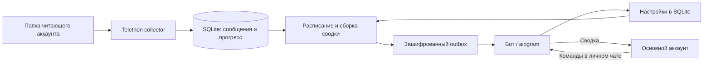

# Архитектура MVP

Реализовано в Python 3.13: Telethon, aiogram, SQLite, один процесс с задачами asyncio. Два пользовательских контекста: отдельный аккаунт читает источники, основной управляет ботом и получает сводки в личный чат.

## Папка и чтение

`/folders` показывает папки **читающего аккаунта**, `/folder ID` сохраняет выбор в БД. Через `messages.getDialogFilters` читаются явно включённые и закреплённые peers, применяются исключения. API папок описан в [официальной документации](https://core.telegram.org/api/folders). Автоматическое вступление в чаты не выполняется.

Сверка состава происходит каждые 300 секунд по умолчанию и перед каждой сводкой. Только после успешного разрешения всех peers состав применяется транзакционно. Удалённые источники выключаются; добавленные начинают с последних 24 часов. Возвращённый источник проходит начальный импорт заново. При изменении состава неотправленные тексты сводок аннулируются, чтобы не доставлять устаревший набор источников. Уже выполняющийся сетевой запрос отменить задним числом нельзя.

Личные диалоги/боты пропускаются. Папки с категориями contacts/non_contacts/groups/broadcasts/bots и фильтрами exclude_read/exclude_muted/exclude_archived отклоняются с объяснением. Это осознанное ограничение MVP: список источников должен зависеть от явного выбора пользователя.

Для каждого источника сохраняется независимый history cursor. Live-события делают upsert сообщений, **не продвигая cursor**. Восстановление читает доступную историю по возрастанию до снимка последнего ID; страницы по 100 просмотренных сообщений и cursor фиксируются одной транзакцией. Сбой между страницами приводит к повторному безопасному upsert, а не к пропуску. Даже если за последние 24 часа сообщений нет, cursor устанавливается в последний доступный ID: второй запуск не начнёт импорт всей старой истории.

События правок заменяют текст. Дополнительно перечитываются последние 100 сообщений для свежих правок, пропущенных офлайн. Удаления по событиям помечаются и исключаются; все удаления и старые правки после долгого простоя не гарантируются. Потерянные события удаления, особенно обычных групп без chat ID, не угадываются.

Сохраняются текст/подписи, UTC-время, ID ответа/темы. Файлы не скачиваются, группировка обсуждений по цепочкам ответов пока не реализована. Защищённые и исчезающие сообщения исключаются. `FloodWait` сохраняет паузу коллектора, не блокируя работу бота и отправку готовых сводок.

## Отбор и AI

В режиме `extractive` ключевые слова ищутся без учёта регистра, исключения применяются первыми. Если темы пусты, подходят все сообщения. Одинаковые тексты после приведения регистра/пробелов объединяются. Сначала выбираются сообщения с большим числом совпавших тем, затем более свежие. Это простая подборка фрагментов, а не смысловое ранжирование. В одном окне рассматриваются максимум 5000 последних сообщений; при достижении лимита сводка сообщает об ограничении. По умолчанию выводится до 10 пунктов.

В режиме `ai` **до HTTP-запроса** остаются только источники с `ai_allowed=1`. Включение на сервере и `/mode ai` не включают доступ всех источников. Новые, возвращённые и переключённые через другую папку источники получают AI: off. Команда `/ai_source ID off` также аннулирует неотправленные тексты сводок.

OpenAI-compatible endpoint получает ограниченный набор выбранных сообщений без Telegram credentials и инструментов. Он возвращает JSON с тезисами и числовыми refs. Приложение проверяет схему и наличие refs во входе, отклоняет произвольные URL; ссылки строятся по известным peer/message ID. Это проверка структуры и происхождения ссылок, **не проверка истинности или полноты тезисов модели**.

Ограничения: один AI-запрос на сводку, до `max_input_chars` символов совокупного входного материала, до 5000 символов отдельного исходного текста, до 2500 выходных токенов. Это MVP без многоэтапного сжатия и embeddings. Ограничение `daily_call_limit` учитывает попытки, в том числе неуспешные; сброс по UTC. Денежный бюджет нужно дополнительно ограничивать у провайдера. Ошибка не запускает скрытую отправку в другой AI-сервис и не продвигает окно.

Тексты и названия источников экранируются как HTML. Части ограничиваются консервативно 3500 UTF-16 units исходного HTML, ниже лимита `sendMessage`. Длинные фрагменты сокращаются с многоточием; ссылка позволяет открыть полный оригинал, если основной аккаунт имеет доступ.

## Расписание и доставка

Настройки папки, тем, исключений, режима и расписания сохраняются в `meta` SQLite. TOML задаёт начальные значения только при первом bootstrap; серверные параметры, owner ID и AI endpoint читаются при каждом старте. Изменения владельца в TOML требуют рестарта; обычные настройки делаются в боте.

Один daily schedule поддерживает до 12 времён в IANA timezone. Seattle — `America/Los_Angeles`. При весеннем скачке несуществующее локальное время переносится на первую допустимую минуту; при осеннем повторе выполняется первый fold один раз. Поздний запуск объединяет пропущенные окна до последнего наступившего слота.

Окно полуоткрытое `[previous_end, scheduled_end)`. `/schedule ...` начинает новое расписание с текущего момента, `/resume` сохраняет предыдущую границу для догоняющей сводки. `/digest` — ручной preview за период от последней границы, ограниченный начальным окном импорта; автоматическую границу не меняет. После очень долгого простоя доступны только данные в пределах retention.

Перед подготовкой все активные источники сверяются. Если источник недоступен, **автоматическая сводка ждёт восстановления**, ошибка видна в `/sources` и `/status`. Частичные сводки и отдельные дополнения пока не реализованы. После восстановления пропущенные окна объединяются. Пустой результат по умолчанию не отправляется, но окно продвигается. При ошибке AI окно остаётся прежним.

`runs.slot` уникален. Run, зашифрованный outbox и продвижение границы фиксируются в одной транзакции. Готовый текст не генерируется заново при повторе доставки. Настройки/состав источников перепроверяются после сетевых ожиданий, чтобы не поставить в очередь результат с уже изменёнными настройками.

Части отправляются последовательно; сохранённые `sent` не повторяются. При известном отказе по частоте учитывается `retry_after`; при permanent bad request/forbidden статус `failed`. Timeout/неизвестный результат — `unknown`, без автоматического повтора. После перезапуска `sending` тоже становится `unknown`; следующие части этого run ждут решения владельца. `/retry ID confirm` явно допускает возможный дубль. Exactly-once через Bot API не обещается.

## Хранение и безопасность

SQLite WAL, короткие синхронные транзакции в одном потоке event loop, один экземпляр на session/bot token. Тексты сообщений и outbox зашифрованы Fernet; key отдельно в `secrets/data.key`. Технические метаданные, темы и названия источников остаются читаемыми. Session и credentials — файлы с ограниченными правами, они не шифруются Fernet.

По умолчанию тексты очищаются каждые ~час по retention 30 дней; минимальные ключи run остаются для идемпотентности. Истёкшие outbox payload удаляются, повтор невозможен. `/purge` отключённого источника удаляет сообщения и все сохранённые тексты outbox консервативно: одна сводка могла объединить несколько источников. Уже доставленные сообщения и резервные копии эта команда не удаляет.

Владелец привязывается одноразовым случайным кодом при `setup`, затем middleware проверяет числовой user ID и private chat ID. Username не является проверкой доступа. Секреты вводятся в терминале VM, в Telegram-командах не принимаются. Сессия чтения даёт права аккаунта: режим «только читать» обеспечивается приложением, не ограниченной Telegram-сессией.

## Проверки и ограничения приёмки

Автотесты покрывают cursor/live race, пустой начальный импорт, правки/upsert, шифрование payload, неверный ключ, membership, retention, окна/DST, остановку при неудачном сборе, авторизацию команд, timeout/retry доставки, AI-фильтрацию до HTTP и недопустимые refs. Docker smoke проверяет установку зафиксированных зависимостей и чтение TOML на Linux x86_64.

Реальная авторизация, доступ к папке, фактическая доставка и выбранная модель требуют credentials пользователя. До их ввода это подготовленный и протестированный сервис, а не подтверждённый end-to-end запуск с Telegram.
