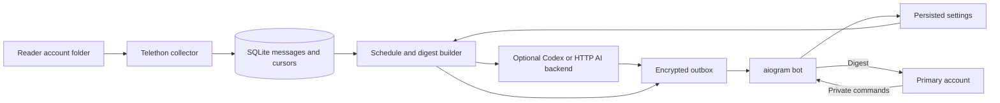

# Architecture

Python 3.13, Telethon, aiogram, SQLite, one application process with asyncio tasks. The reader account and bot owner are separate. Source code and controls are English; digest language is persisted as a bot-selected client preference.

## Membership and collection

`messages.getDialogFilters` supplies explicit included/pinned peers and exclusions. See [Telegram folder documentation](https://core.telegram.org/api/folders). Collection never automatically joins chats. Personal dialogs, bots, and protected sources are skipped. Dynamic categories and unread/muted/archive filters are intentionally unsupported.

Folder membership changes are applied atomically after all peers resolve. Removed sources are disabled; new/re-added sources import the latest 24 hours and start with AI access off. Membership changes invalidate unsent digest payloads. A network request already in flight cannot be retracted.

Each source has its own history cursor. Live events upsert messages but never advance that cursor. Recovery scans forward to a snapshot of the latest ID, committing pages of 100 inspected messages with the cursor in one transaction. A crash repeats an upsert rather than skipping the middle of the range. An empty initial time window still advances to the snapshot ID, preventing accidental full-history import next time.

Edits replace message text. The latest 100 messages are reread for recent offline edits; older offline edits and every deletion cannot be guaranteed. Deletion events without an identifiable source are not guessed. Text/captions, UTC timestamps, reply IDs, and topic IDs are retained; media files are not downloaded and reply-chain clustering is not yet implemented.

`FloodWait` pauses collection without blocking bot controls or delivery of completed digests. Failed source synchronization prevents the scheduled window from advancing. Partial digests and later supplements are not implemented yet; windows coalesce after recovery.

## Selection, language, and AI

Extractive selection applies case-insensitive exclusions, then topics. Empty topics match everything. Texts equal after whitespace/case normalization are deduplicated. Ranking uses the number of topic matches, then recency. Up to 5000 latest messages are considered per window; capped windows are labeled. The default digest has at most 10 items.

`/language en|ru` persists a client preference. English is the fallback for an older database without this field. Translated digest labels live in locale JSON resources, outside application logic. Extractive text remains in its original language; AI instructions select the client's requested output language. Changing language/settings during an in-flight build prevents queuing a stale result.

AI filtering occurs before requests: only `ai_allowed=1` sources enter either backend. Server enablement and `/mode ai` do not grant all sources access. `/ai_source ID off` invalidates pending payloads. The offline `configure --enable-ai-for-folder` option is an explicit administrative opt-in for the currently selected folder's active sources.

Backends:

- `chat-completions`: a configured compatible endpoint receives bounded messages and returns JSON.
- `codex`: the authenticated CLI receives the prompt over stdin, uses a temporary working directory, and returns schema-constrained JSON. User/project configuration, shell, browser, plugins, agents, and other tools are disabled. Runs use `--ephemeral` and a read-only sandbox. Unexpected tool activity is rejected; timeout/cancellation kills the process group. Auth refresh state persists in the mounted private Codex home.

The application verifies output shape, known reference IDs, and absence of generated URLs. Links are constructed from known source/message IDs. This is provenance/structure validation, not a proof of factual accuracy. Input messages remain untrusted data, never instructions for operating the VM.

AI input selection round-robins across eligible sources rather than taking only the latest output-sized batch. Up to 200 candidates are considered, with a first-pass input share reserved per source. Actual serialized JSON size is bounded, including delimiters and escaping; the digest reports how many sources/messages entered the model. One AI request is made per digest, within daily-attempt and input-size limits. Failed attempts count. Individual message input is truncated at 5000 characters; aggregate material is bounded by `max_input_chars`. The HTTP backend requests at most 2500 output tokens; Codex uses the constrained output schema and request timeout. There is no multi-stage compression or embedding store yet.

## Scheduling and outbox

One daily schedule supports up to 12 wall-clock times in an IANA zone. Seattle uses `America/Los_Angeles`. Spring-forward gaps move to the first valid minute; fall-back repeats run once using the first fold. Missed windows coalesce up to the latest due slot.

Windows are half-open `[previous_end, scheduled_end)`. `/schedule ...` starts at the current moment; `/resume` preserves the prior boundary for catch-up. `/digest` is a preview, bounded by the initial import window, and does not advance scheduled boundaries. Very long downtime is limited by retention.

All active sources synchronize before a digest. Unique `runs.slot` keys prevent duplicate generation. Run metadata, encrypted outbox parts, and window advancement commit atomically. Empty scheduled digests advance the window but are silent by default. AI failures leave the boundary unchanged and appear in `/status`.

Parts are sent sequentially. Confirmed `sent` parts are never automatically repeated. Known rate-limit rejection honors `retry_after`; permanent rejection becomes `failed`. A timeout/uncertain result becomes `unknown`, as does interrupted `sending` after restart. Later parts of that run wait. `/retry ID confirm` deliberately accepts a possible duplicate; exactly-once delivery is not promised.

`configure --queue-digest` queues an idempotent initial preview for the named folder before startup. The operator explicitly authorizes delivery to the paired owner. No message is sent to any other destination.

## Storage and access

SQLite WAL with short transactions on the event-loop thread. A filesystem session lock prevents concurrent reader/auth/configure processes. Operational `status` uses a read-only database connection. Metadata schema version is currently 1; language/settings additions need no table migration.

Fernet encrypts message text and outbox payloads. Its key is separate in `secrets/data.key`. Technical metadata and settings remain plaintext. Telegram sessions, bot credentials, and Codex auth cache are private files, never image layers or Git content. The Codex executable is pinned and verified against the official archive SHA-256.

Hourly cleanup expires text after 30 days by default, retaining minimal run keys for idempotency. `/purge` removes a disabled source's messages and all retained outbox text conservatively because summaries can combine sources. Delivered bot messages and external backups are outside this deletion path.

Owner pairing uses a one-time random bot command. Middleware checks numeric user ID and private chat ID; usernames are not authorization. All normal client settings are persisted in SQLite. TOML controls server paths/provider settings and only seeds client settings at first bootstrap.

## Verification

Tests cover collection/live races, empty initial imports, updates, encryption, membership changes, retention, restart-safe delivery, uncertain outcomes, schedule/DST boundaries, owner-only controls, login cancellation and QR refresh/2FA, client-selected language, and AI request/citation boundaries. Container checks verify pinned dependencies, read-only runtime storage, and packaged resources.

Real reader authorization, source access, model access, and delivery are checked separately on the target VM. No test credentials are committed.
