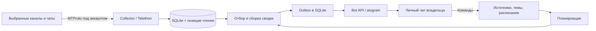

# Предлагаемая архитектура

Это проект реализации, а не описание уже работающего приложения. Основной сценарий подтверждён пользователем: преимущественно чужие источники.

## Поток данных

Один контейнер и один процесс с задачами asyncio: collector, scheduler, delivery worker, bot polling. Транзакции короткие; сетевые обращения вне транзакций. SQLite WAL на локальном диске VM, один сериализованный writer. Вынос в PostgreSQL и отдельные worker-процессы потребуется при нескольких пользователях или конкурирующей записи; для личного MVP это лишнее.

## Сбор и восстановление

1. При первом подключении проверить конфигурацию и доступ к каждому источнику. Username/ссылка используются для разрешения сущности; дальше хранить устойчивый Telegram peer ID и его тип. Не писать содержимое сообщений в журналы.
2. Подключить приём новых сообщений до начального импорта. Импортировать ограниченное окно, например последние 24 часа; параллельные события проходят через тот же upsert. Дубли поглощает `(source_id, message_id)`.
3. Для каждого источника сохранять `history_cursor`: последнюю полностью пройденную позицию восстановления. Не сдвигать его до максимального ID только из-за прихода live-события — иначе можно пропустить сообщения между ними.
4. При старте/переподключении дочитать доступную историю после cursor по возрастанию, с пагинацией. Записи и продвижение cursor фиксировать одной транзакцией по завершении страницы. Ограничение начального импорта не применять молча к восстановлению после простоя.
5. Периодически повторять сверку, с ограничением частоты и небольшим перекрытием для свежих правок. Одинаковые ID не означают одинаковый текст: обновлять content hash и время редактирования.
6. Полученные удаления помечать и исключать из будущих подборок; свежие кандидаты по возможности перепроверять перед отправкой. Недоступный источник помечать как ошибку доступа, а не как пустой. Обнаружение всех удалений API не гарантирует.

Хранить текст и подписи, время UTC, автора при необходимости, `reply_to`, forum topic, grouped/media ID, признаки защищённого/исчезающего контента. Медиа не скачивать. Защищённый и исчезающий контент для MVP исключить. Подписка на канал и связанная группа обсуждений — разные источники, доступ к одному не означает доступ к другому.

## Минимальные сущности хранения

| Сущность | Поля и ограничения |
| --- | --- |
| `sources` | ID и тип peer, title, username, enabled, priority, history_cursor, last_sync_at, access_error |
| `messages` | UNIQUE(source_id, message_id), date_utc, edited_at, text, content_hash, reply_to, topic_id, deleted_at |
| `schedules` | ID, набор источников, local times, IANA timezone, next_due_at_utc, last_window_end_utc, версия настроек |
| `digest_runs` | UNIQUE(schedule_id, scheduled_at_utc), window_start/end, collection_status, config_version, content, status |
| `digest_items` | run_id, source/message IDs, версия текста, порядок; связь тезисов с оригиналами |
| `outbox` | UNIQUE(run_id, recipient_id, part_index), payload, pending/sending/sent/unknown/failed, telegram_message_id, attempts, next_attempt_at |
| `owner_settings` | Telegram user ID владельца, приватный chat ID доставки, темы и исключения |

Текст сообщений, промежуточные сводки и outbox содержат приватные данные. Предлагаемый срок хранения — 30 дней, настраиваемый. Позиции чтения и минимальные ключи завершённых запусков сохранять дольше без исходного текста, чтобы очистка не запускала повторный импорт/отправку. Каскадно удалять производные тексты и кеши по истечении срока или отключении источника с удалением данных. Резервные копии должны иметь собственный ограниченный срок хранения.

## Расписание

- Пользователь задаёт, например, 09:00 и 20:00 в `America/Los_Angeles`; это только пример, фактическое время ещё не выбрано. В БД хранить моменты в UTC, расписание — с IANA timezone.
- Слот запуска уникален по расписанию и запланированному UTC-времени. Планировщик регулярно ищет просроченные слоты; перезапуск контейнера не должен создавать второй run.
- При переходе DST: несуществующее локальное время переносить на первый допустимый момент после скачка; повторяющееся выполнять один раз, с первым смещением. Это проектная политика, которую надо покрыть тестами. Для преобразований использовать [zoneinfo](https://docs.python.org/3/library/zoneinfo.html).
- Окно сообщений — `[предыдущая граница, текущая запланированная граница)`, а не «последние 12 часов от фактического старта». Первая граница определяется начальным импортом. Ручной `/digest` по умолчанию создаёт preview и не продвигает автоматическую границу.
- До фиксации материала сверить источники до границы. Если сверка не завершилась, оставить run ожидающим; по истечении лимита явно выбрать частичную сводку с перечнем недоступных источников. Пропуски позднее доставлять отдельным дополнением с отслеживанием уже включённых ID.
- После длительного простоя объединять неотправленные окна в одну догоняющую сводку, записывая покрытые слоты транзакционно. Не отправлять десятки старых уведомлений.
- Фиксировать текст и outbox в одной транзакции; только затем продвигать границу планировщика. Доставка повторяет сохранённый payload, не генерирует другую сводку при каждой попытке.

## Надёжность доставки

Уникальные ключи предотвращают повторную генерацию и повторную постановку частей. После успешного ответа сохранять Telegram message ID. Доставлять части последовательно; после рестарта продолжать с неотправленных.

**Exactly-once доставку через Bot API обещать нельзя:** если Telegram принял сообщение, а ответ потерялся или процесс упал до записи результата, отправитель не знает исхода. Такой запрос помечать `unknown`, показывать в `/status` и не повторять автоматически до решения владельца. После рестарта незавершённое `sending` также превращать в `unknown`. Это даёт явную неопределённость вместо скрытых дублей; нужна команда ручного повтора с предупреждением о возможном дубле. Ошибки с известным отказом и `retry_after` можно повторять с backoff и jitter.

`FloodWait` коллектора не должен останавливать команды бота и доставку уже готовых сводок. Потеря авторизации требует вмешательства владельца; это не бесконечная retry-ошибка. Когда доставки нет из-за блокировки бота, сохранить outbox и сигнал в health/status.

## Интерфейс бота

Все команды и callbacks проверяют числовой `owner_user_id`; username не является проверкой доступа. Команды управления принимаются только в личном чате владельца.

- `/start`, `/help` — назначение и настройка получателя.
- `/sources`, `/add`, `/remove` — доступные источники, добавление после проверки доступа, отключение и отдельное удаление сохранённых данных.
- `/topics` — темы и исключения.
- `/schedule` — время и часовой пояс с подтверждением фактически рассчитанных следующих запусков.
- `/digest` — подборка сейчас; `/pause`, `/resume` — автоматическая доставка.
- `/status` — последняя синхронизация, backlog, недоступные источники, ближайший запуск, ошибки доставки без секретов.

Перед переключением получателя с личного чата на группу нужна отдельная настройка доступа: нельзя случайно переслать туда содержимое приватных источников.

## Этапы и критерии готовности

1. **Каркас и чтение:** Dockerfile/Compose, зафиксированные зависимости, миграции, интерактивная авторизация, collector и SQLite. Проверка на нескольких доступных источниках: новые сообщения, правки, дубли, реконнект, отсутствие пропусков при импорте.
2. **Полезная подборка:** темы и исключения, дедупликация, ссылки, ручной preview и доставка владельцу. Проверить качество на размеченной владельцем выборке и длинные сообщения с HTML/emoji.
3. **Автоматическая работа:** расписание, persisted runs/outbox, DST, восстановление после остановки, частичная доставка и unknown-исходы. Проверить рестарт между отправкой частей и границы окон.
4. **Эксплуатация:** healthcheck по состоянию задач, ротация логов, backup/restore, срок хранения, деплой на VM. Приёмка: восстановление из копии в отдельном каталоге, запуск без повторной авторизации и без повторной отправки завершённых run.
5. **Опциональный AI:** только для источников с установленным основанием обработки; лимиты токенов, валидация ссылок, бюджет, оценка качества. До этого этапа подобрать провайдера и провести небольшой замер; наличие GPU и качество локальной модели пока не проверялись.

Главные интеграционные проверки должны моделировать реальные сбои и потери прогресса. Авторизация, доступ к конкретным источникам и реальная доставка дополнительно требуют ручной проверки с Telegram credentials, которых в репозитории нет.
